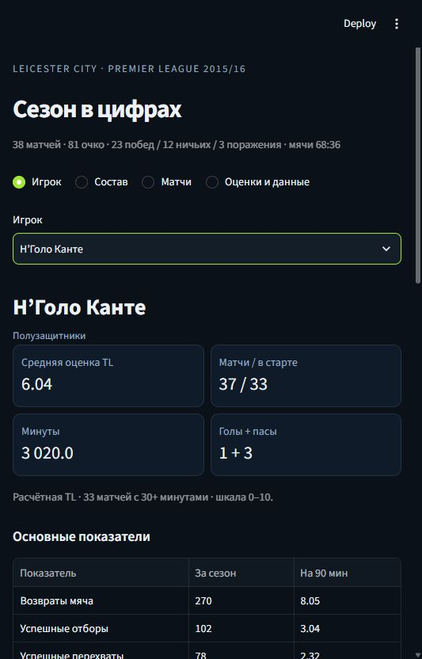
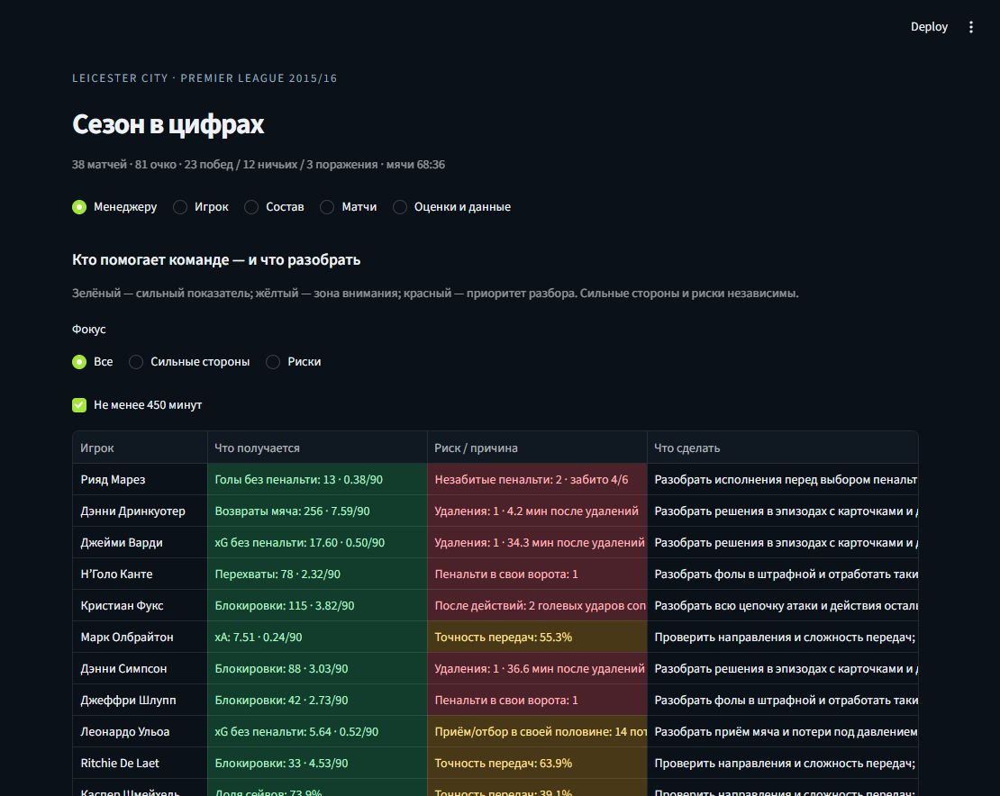

# Leicester Season Lab

**Leicester City, Premier League 2015/16: who contributed, how each player performed,
and which documented actions deserve closer review.**

38 matches · 23 players · Python · SQL · pandas · scikit-learn · LLM

The default app opens a compact manager review: strengths, concrete risks and next review
actions, highlighted green/yellow/red. Contribution and risk are independent. The player
section opens N'Golo Kanté's card: minute-weighted TL rating, appearances, minutes and eight
relevant statistics. There are no charts in the primary interface.

<details>
<summary>Player-card preview</summary>

</details>

<details>
<summary>Manager review with colour-coded reasons</summary>

</details>

## What is included

- **Manager view:** green strengths, yellow attention points and red episode-review priorities,
  each with numbers, reasons and an action. Contribution and risk stay separate; the same player
  can be green for interceptions and red for a penalty conceded. See [signal rules](docs/manager-signals.md).
- **Player cards:** totals and per-90 figures, appropriate to the player's role.
- **Formation and roles:** an internet-sourced public-domain pitch, actual starting XIs,
  shirt numbers and positions for all 38 matches. Select a player to compare statistics
  from appearances in that role with EPL peers; see [method and sources](docs/tactics.md).
- **Every statistic is coloured:** strengths, attention, priority, neutral context or insufficient
  data. Both tables and header cards have explanations; see [colour rules](docs/metric-colours.md).
- **Squad:** sortable season table, a 450-minute eligibility filter and leaders in goals,
  assists, chance creation, recoveries, interceptions and tackles.
- **Matches:** Leicester's 38 fixtures, results and individual match ratings.
- **Negative events:** penalties conceded/missed, fouls near the penalty area, cards,
  own goals, poor control, turnovers and selected opposition-shot sequences.
- **Goalkeepers:** saves, save percentage, penalties faced/saved/allowed, failed handling
  and goals from low pre-shot xG. The last category is a review flag, not proof of an easy save.
- **Transparent TL ratings:** role-profile percentiles, visible episode deductions,
  minimum match minutes and a minute-weighted season average. These are our engineered
  descriptive ratings, not an official/expert service's scores.
- **Optional LLM:** a short player-season explanation using a structured evidence packet,
  validated evidence references and the OpenAI Responses API.
- **Research:** an evaluated own-xG experiment, an executed notebook, reports, tests and CI.

## Read the research

| Artifact | Contents |
| --- | --- |
| [Leicester season study](reports/leicester-season.md) | Player totals, contribution leaders, keeper statistics and discipline |
| [TL formula](docs/leicester-rating.md) | Peer groups, weights, aggregation, deductions and limitations |
| [ML study](reports/research.md) | EPL dataset audit, chronological own-xG experiments and calibration |
| [Executed notebook](notebooks/01_exploration.ipynb) | SQL, pandas exploration and model-protocol checks |
| [Player-event definitions](docs/player-analysis.md) | Action categories, sequence rules and attribution boundaries |
| [LLM evaluation rubric](docs/llm-evaluation.md) | A protocol for reviewing factual and interpretive accuracy |

The earlier all-league match explorer is preserved at `archive/match_app.py`; it is not the
default interface. Its event-level minute calculations include stoppage time, whereas the
new season dashboard uses regulation-time minutes for per-90 comparison.

## Run

Python 3.12 is the tested environment. From the repository root:

```powershell
python -m venv .venv
.\.venv\Scripts\Activate.ps1
python -m pip install -r requirements.txt
python -m touchline.download
python -m touchline.ingest
python -m touchline.season
python -m streamlit run app.py
```

On macOS/Linux activate with `source .venv/bin/activate`. Without PowerShell activation,
call `.\.venv\Scripts\python.exe` directly. `requirements-lock.txt` records the exact tested
package environment.

The source acquisition caches all 380 EPL matches because the rating reference group and
ML experiments need same-position peers; the product displays **only Leicester's 38 games**.
Downloads are pinned, resumable and checksum-verified, with about 100 MB compressed raw JSON.
Allow at least 1 GB for the environment, cache and generated database. A complete source
season is required for the published dashboard and rating reference.

To rerun just the rating calculation after changing weights:

```bash
python -m touchline.season --ratings-only
```

After changing event definitions, run the full season command instead. SQLite and trained
model binaries are generated locally and excluded from Git; CSV summaries and provenance
are included.

## The assignment tools

| Tool | Actual use |
| --- | --- |
| Python | Source acquisition, event normalization, metrics, ratings, reports and app |
| SQL / SQLite | Indexed event storage, joins, analytical views and player/season tables |
| pandas | Feature preparation, weighted aggregation, ratios and per-90 tables |
| scikit-learn | Own xG: Logistic Regression vs HistGradientBoosting, preprocessing and evaluation |
| Visualization | Compact tables/cards in the app; scientific figures and calibration in the study |
| LLM | Optional evidence-grounded season explanation with validated references |

The TL rating is an explicit engineered formula. It is **not** falsely presented as a trained
ML model. The own-xG model is a separate scikit-learn experiment:

```bash
python -m touchline.modeling
python -m touchline.research
```

Selection uses chronological validation log loss, with later dates held out for test. Shots
and paired team perspectives from one match stay together. Preprocessors fit train only.
The included own-xG model achieves test ROC AUC about 0.781 and log loss about 0.289, versus
0.345 for a constant training-rate baseline. Provider xG is an external richer-information
reference, not an equal-input independent competitor. See `artifacts/metrics.json`.

## Optional LLM

Copy `.env.example` to `.env` and set `OPENAI_API_KEY` and an `OPENAI_MODEL` available in your
account that supports structured text output. The integration follows the
[OpenAI Responses API](https://developers.openai.com/api/reference/python/resources/responses/methods/create).
Generation happens only when the user presses the button in the collapsed AI section.
Requests use `store=False`; the key is not committed. API usage may incur charges.

The model receives calculated public player-season facts and must cite existing evidence
IDs. Reference validation does not prove logical support for every interpretation. Live API
generation has not been verified without a configured key/model; the main dashboard does
not need a key. No template is passed off as a live LLM output.

## Checks and reproducibility

```bash
python -m ruff check .
python -m pytest -q
```

Generate the manager summary and evidence CSVs with `python -m touchline.manager`.

Unit tests do not need downloads. Real-data checks run when the database exists; the season
app checks run after building season artifacts. Tests cover penalty/restart linking, one
deduction for a penalty+red+goal episode, weighted averages, percentage denominators,
short appearances, source scores, known Leicester totals and the four application sections.
GitHub Actions skips unavailable data-dependent checks in a clean checkout.

## Data and limitations

**Data source: StatsBomb**, via [hudl/open-data](https://github.com/hudl/open-data), competition
`2`, season `27`, pinned commit in `touchline/config.py` and `artifacts/manifest.json`.
The full source audit reconciles all 380 scores, including own goals. One out-of-grid shot
is retained in source/provider totals and excluded from the own-xG experiment.


An action followed by a goal is not automatically its sole cause. Low pre-shot xG does not
mean an easy save; this feature has no PSxG. Tracking/video would be needed to judge unseen
marking or an available pass the player did not choose. Ratings depend on chosen weights,
event definitions, team style and exposure; narrow rating differences should not be overread.
Assists and other counts follow StatsBomb's annotations and can differ from other providers.

Project code is MIT licensed. The data and official logo retain the source repository's terms;
the code license does not license the underlying data.
