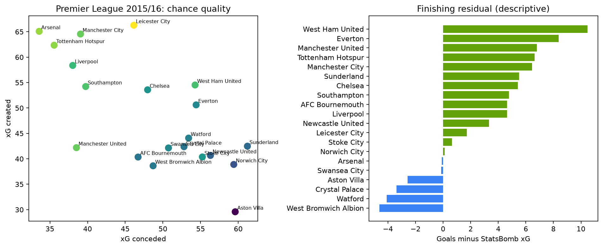
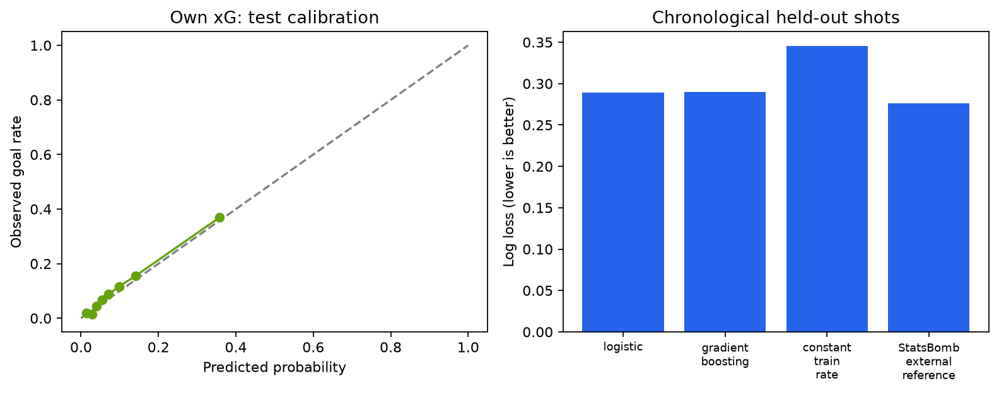

# Touchline Lab: факторы результатов АПЛ 2015/16

## Аннотация

Исследуем, какие наблюдаемые игровые показатели связаны с результатами матчей.
Выборка: 380 матчей, 1,313,773 событий и 9,908 ударов.
Проект объединяет событийный анализ, собственную модель xG, интерпретируемую классификацию
исхода и LLM-отчёты с проверяемыми ссылками на события. Это наблюдательное исследование;
полученные связи не являются оценками причинного эффекта.

## Данные и контроль качества

Источник: [StatsBomb Open Data](https://github.com/hudl/open-data), коммит `4b73468fc5b0f1950f9f66fada70ad3a4f9327cb`.
АПЛ 2015/16, competition_id=2, season_id=27. В исходном каталоге 380 матчей.
SHA-256 каждого исходного JSON сохранён в `artifacts/manifest.json`. Исходные JSON сжаты
в локальном кэше, нормализованные события хранятся в SQLite. Сырые данные не входят в Git.

- Несоответствий событий официальному счёту: 0.
- Ударов с недопустимым xG: 0.
- Ударов с координатами за пределами поля: 1.
  Их исходные значения сохранены, они исключены из обучения и оценки собственного xG,
  но включены в матчевую статистику и суммы провайдерского xG. В закреплённой версии
  событие `538f0ed8-576f-420c-adab-09e8c97c34b4` имеет x=120.2, y=1.0 (удар с углового).
  Грубых выходов координат более чем на единицу сетки: 0.
- Автоголов: 38; они учитываются через Own Goal Against и не дублируются.
- Дубли event_id запрещены первичным ключом, связи проверяются внешними ключами SQLite.
- Матчей у каждой команды: 38–38.

## Вопросы и определения

1. Как связаны качество моментов и результат? xG — сумма вероятностей гола после ударов.
2. Как соотносятся фактические голы и xG за сезон? Разница не является чистой мерой удачи
   или мастерства: она также зависит от неопределённости и спецификации модели.
3. Какие признаки связаны с оценкой победы/ничьей/поражения? Используем разности xG, ударов,
   входов в штрафную, точности передач, событий давления, удалений и домашнее поле.

Вход в штрафную — точная передача или ведение из-за пределов зоны x ≥ 102, 18 ≤ y ≤ 62
внутрь неё на сетке StatsBomb 120 × 80. Pressure — зарегистрированное действие давления,
а не показатель успешности прессинга. Узлы сети передач — средние начала точных передач,
а не средние позиции игроков из трекинга.

## Описательные результаты

- Доля побед хозяев: 41.3% (157 из 380).
- Команда с большим xG выиграла в 54.5% случаев (207 из 380).
- У 66 победителей xG был ниже, чем у соперника.
- Корреляция разницы xG с разницей голов: 0.613.
- Наибольшие положительные сезонные разницы голов и xG: West Ham United (+10.47), Everton (+8.39), Manchester United (+6.80).



Эти показатели описывают выборку. В корреляции использованы обе командные перспективы;
они зависимы, поэтому строки не трактуются как независимые наблюдения для проверки гипотез.
Результаты не доказывают, что дополнительные удары или давление сами по себе вызвали победу.

## Эксперимент 1: собственный xG

Цель — предсказать бинарный исход удара (гол / не гол). Доступные в момент удара признаки:
дистанция, угол, часть тела, техника, тип удара, давление и удар в одно касание.
Исход, конечные координаты удара, фактический счёт, имя игрока и StatsBomb xG исключены.
Пенальти включены как известный тип удара. Отдельная оценка пенальти и непенальти является
полезным следующим шагом; на малой выборке пенальти интервалы будут широкими.

Сравниваются Logistic Regression и HistGradientBoosting. Настройки моделей зафиксированы
в коде; выбор семейства выполнен по validation log loss. Простая база — частота голов на train.
StatsBomb xG показан как внешний ориентир: он использует более богатую информацию и
его обучающая выборка нам неизвестна, поэтому это не независимый конкурент с теми же данными.

Разделение по уникальным датам: train до 2016-01-24, validation до
2016-04-09, test — позже. Матчей:
230 / 90 / 60.
Ударов: 5906 / 2352 / 1649.
Все события матча находятся в одной части. Преобразования обучены только на train.
Выбранная модель: **logistic**. Тест не используется для выбора.

| model | log_loss | brier | roc_auc |
| --- | --- | --- | --- |
| logistic | 0.2894 | 0.0836 | 0.7814 |
| gradient_boosting | 0.2900 | 0.0831 | 0.7759 |
| constant_train_rate | 0.3454 | 0.0974 | 0.5000 |
| StatsBomb_external_reference | 0.2761 | 0.0781 | 0.7993 |

95% интервал test log loss выбранной модели: 0.2597–0.3178.
Бутстрэп по матчам, 1000 повторов, seed=42. Калибровка построена по 8 квантильным группам.
Средний xG на test: 0.100; фактическая доля голов: 0.109.



## Эксперимент 2: объяснение исхода сыгранного матча

Мультиномиальная логистическая регрессия: победа, ничья, поражение. Каждому матчу соответствуют
две командные строки. Разделение совпадает с первым экспериментом; обе строки остаются вместе.
Нормализация обучена на train, C выбирается из 0.1 / 1 / 10 по validation log loss.
Разница голов и сам результат не входят в признаки. Используется **провайдерский xG**;
собственный xG не подставляется в эту модель, чтобы не смешивать эксперименты.

| model | log_loss | brier | accuracy |
| --- | --- | --- | --- |
| logistic | 0.9905 | 0.5915 | 0.5167 |
| train_class_frequencies | 1.1001 | 0.6676 | 0.3417 |

Для каждого матча вычисляются точные вклады признаков в логарифм отношения вероятностей
предпочтительного класса к следующему по вероятности. Сумма вкладов и intercept равна
log(P(класс 1) / P(класс 2)). Это объяснение модели, а не оценка причинного эффекта.
Модель использует итоговую статистику: её метрики **не являются качеством предматчевого прогноза**.

## Ход матча и условный эксперимент

Приложение показывает события при равном счёте, лидерстве и отставании. Гол засчитывается
после соответствующего события; автоголы учитываются один раз. Минуты считаются по времени
каждого тайма с добавленным временем. Показатели на 90 минут нестабильны на коротких отрезках.

Условный повтор тех же ударов рассчитывается точной свёрткой распределений Бернулли
(Poisson-binomial). Предполагаются независимость ударов и неизменный набор моментов;
не учитываются новые атаки, автоголы и изменения поведения после гола. Это не прогноз
реального переигранного матча и не вероятность «заслуженной» победы.

## Индивидуальные действия и линии команды

В основном разделе приложения добавлены отдельные показатели вратарей, защитников,
полузащитников и нападающих. В загруженной выборке есть 178 событий Error,
10,786 Miscontrol и 10,520 Dispossessed.
Это разные категории: только Error обозначается как явная ошибка
провайдера, а потеря мяча после отбора или рискованной передачи не равна доказанной ошибке.

Изучаются цепочки действий с первым ударом соперника в заданном окне (по умолчанию 20 с),
без перехода в другой тайм, возврата контроля и остановки игры. Один удар не суммируется
несколько раз в итогах по игрокам. Правило выбора последнего действия для таких итогов
является правилом отчётности, а не причинным распределением вины.

Реальный пример: Watford 1–2 Stoke City, 19 марта 2016, match_id=3753977.
У вратаря Heurelho da Silva Gomes зарегистрирована неточная передача в 50:37
(`417dbf67-0319-4f7f-ad1f-5c1ea58769b7`). Через 5.4 с в эпизоде соперника зарегистрирован
голевой удар xG=0.0679 (`494fed16-e21b-43cd-a4e0-f8ef2e0ecaf0`). Это полезный эпизод
для разбора неудачного распределения мяча, но он не доказывает, что только вратарь
стал причиной всего поражения. У самой передачи нет явного тега Error.

Положение невыбранных адресатов передач не наблюдается: отсутствие ключевого паса
не позволяет доказать упущенную доступную передачу. Для оценки ошибок вратаря на линии
недостаточно обычного xG; PSxG в этой функции не используется. Определения и границы
приведены в `docs/player-analysis.md`.

## LLM и проверка отчётов

В LLM передаются рассчитанные факты и UUID ключевых событий. Ответ имеет JSON-схему;
каждый раздел должен содержать существующие evidence_ids. Проверка отклоняет неизвестные
или пустые ссылки. В интерфейсе можно раскрыть факты и скачать отчёт. Без ключа API
показан явно обозначенный шаблон, а не имитация ответа LLM.

Наличие корректной ссылки само по себе не подтверждает логическую обоснованность вывода.
Рекомендуемый ручной протокол: выбрать матчи с победой фаворита, неожиданным результатом,
ничьей, удалением и автоголом; оценить точность чисел, поддержку каждого утверждения и
отсутствие выдуманной тактики. Живой API-вызов требует пользовательского ключа и модели.

## Ограничения и вывод

Один исторический сезон не гарантирует перенос на современный футбол. Межматчевая
зависимость команд полностью не устранена кластерным бутстрэпом. Обученные на ранних
матчах модели показывают для них in-sample оценки; только test используется для независимых
метрик. Freeze frames при ударах не являются непрерывным трекингом. Нет полной информации
о травмах, нагрузке, тренерских заданиях и позициях игроков между событиями.

Итог: можно воспроизводимо связать результат с наблюдаемыми моментами, продвижением мяча
и оценками моделей, а затем представить подтверждения пользователю. Причинные утверждения
потребуют отдельного дизайна исследования и более богатых данных.

## Воспроизведение

```bash
python -m touchline.download
python -m touchline.ingest
python -m touchline.modeling
python -m touchline.research
python -m pytest
streamlit run app.py
```

Data source: StatsBomb. Условия данных и официальный логотип: [исходный репозиторий](https://github.com/hudl/open-data).
